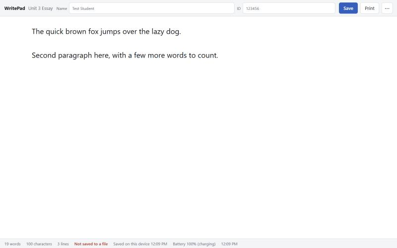

# WritePad

A plain, distraction-free text editor for exams on Chromebooks, built to replace
the ShinyShiny Chrome App now that Chrome Apps are being removed from ChromeOS.

It is a single static web page. Students type, their work is saved on the device
as they go, and when they are done they **Save** a text file or **Print**.
Nothing else. No accounts, no network calls, no analytics, no external assets.



## Features

- **Never loses work.** Every keystroke is saved to the device's local storage.
  If the Chromebook restarts or the app is closed, the next launch offers to
  restore the work. The last five cleared documents are kept under
  *Recover a previous document* in the menu as a second safety net.
- **Student name and ID** fields that go into the filename, the text file
  header, and the printed header.
- **Save** to a real text file through the browser's save dialog (USB drive,
  Downloads, etc.). Falls back to a plain download if the dialog is blocked.
  `Ctrl+S` re-saves to the same file without asking again.
- **Print** with a clean header (name, ID, exam title, date) and a word count
  footer. Works with printers pushed by Google Admin policy.
- Live **word, character, and line count**, autosave status, battery, and clock
  in the status bar.
- Text size, font (sans, serif, mono), and light/dark theme, remembered per
  device.
- **Finish & clear** for the next student, with a warning if the current
  document was never saved to a file.
- Works **offline** after the first launch (service worker).
- Spellcheck is **off** by default. Nothing autocorrects.

## URL options

Add these to the kiosk URL to change behavior. They can be combined.

| Parameter        | Effect                                                   |
| ---------------- | -------------------------------------------------------- |
| `?title=...`     | Exam title shown in the header and on printouts          |
| `?spell=1`       | Turn spellcheck on                                       |
| `?nofields=1`    | Hide the Name and ID fields                              |
| `?size=24`       | Starting text size in px (14 to 40)                      |
| `?font=serif`    | Starting font: `sans`, `serif`, or `mono`                |

Example: `https://YOURORG.github.io/writepad/?title=Unit%203%20Essay&size=24`

## Keyboard shortcuts

| Keys                  | Action                   |
| --------------------- | ------------------------ |
| `Ctrl+S`              | Save as a text file      |
| `Ctrl+P`              | Print                    |
| `Ctrl+Plus` / `Minus` | Larger or smaller text   |
| `Ctrl+0`              | Reset text size          |
| `F1`                  | Help                     |
| `Esc`                 | Close a dialog or menu   |

## Hosting on GitHub Pages

1. Push this repository to GitHub.
2. In the repository, open **Settings → Pages**.
3. Under **Build and deployment**, set **Source** to *Deploy from a branch*,
   pick the `main` branch and the `/ (root)` folder, and save.
4. After a minute the site is live at `https://OWNER.github.io/writepad/`.

All paths in the app are relative, so it works at a sub-path like `/writepad/`
or at a custom domain. GitHub Pages serves everything over HTTPS, which the
service worker and PWA install require.

### Updating

Edit the files, bump `VERSION` in `sw.js` and `APP_VERSION` in `app.js`, commit,
and push. Devices pick up the new version on their next launch. The service
worker never reloads a page on its own, so a student mid-exam is never
interrupted.

## Setting up the Chromebook kiosk

In the Google Admin console:

1. Go to **Devices → Chrome → Apps & extensions → Kiosks**.
2. Choose the organizational unit that holds the exam Chromebooks.
3. Click **+** (bottom right) → **Add by URL** and paste the GitHub Pages URL,
   including any `?title=` options you want.
4. Set it to **Installed** and, if you want the device to boot straight into
   it, set **Auto-launch app** to WritePad.
5. Under **Devices → Chrome → Settings → Device**, check the kiosk settings for
   that OU. Things to verify on a test device before exam day:
   - Printing: printers are pushed by policy and `Ctrl+P` reaches them.
   - Saving to USB: the save dialog can see removable storage. If it cannot,
     check the *External storage* device policy. The download fallback still
     writes to the kiosk's Downloads folder, which may be wiped between
     sessions.
   - Local storage persists between kiosk launches (it should by default) so
     the autosave recovery works.

Students can practice in a normal browser tab at the same URL. It behaves the
same way outside kiosk mode.

## Development

It is static HTML, CSS, and JavaScript with no build step. Serve the folder
with any static server, for example:

```bash
python -m http.server 8765
```

Then open <http://localhost:8765/>.

Icons are generated by `tools/make_icons.py` (needs Pillow). Re-run it if you
change the design.

## Files

| File                     | Purpose                                     |
| ------------------------ | ------------------------------------------- |
| `index.html`             | The page                                    |
| `styles.css`             | Styles, light/dark themes, print layout     |
| `app.js`                 | All behavior                                |
| `sw.js`                  | Service worker for offline use              |
| `manifest.webmanifest`   | PWA manifest                                |
| `icons/`                 | PWA icons and favicon                       |
| `tools/make_icons.py`    | Icon generator                              |

## License

MIT. See [LICENSE](LICENSE).
